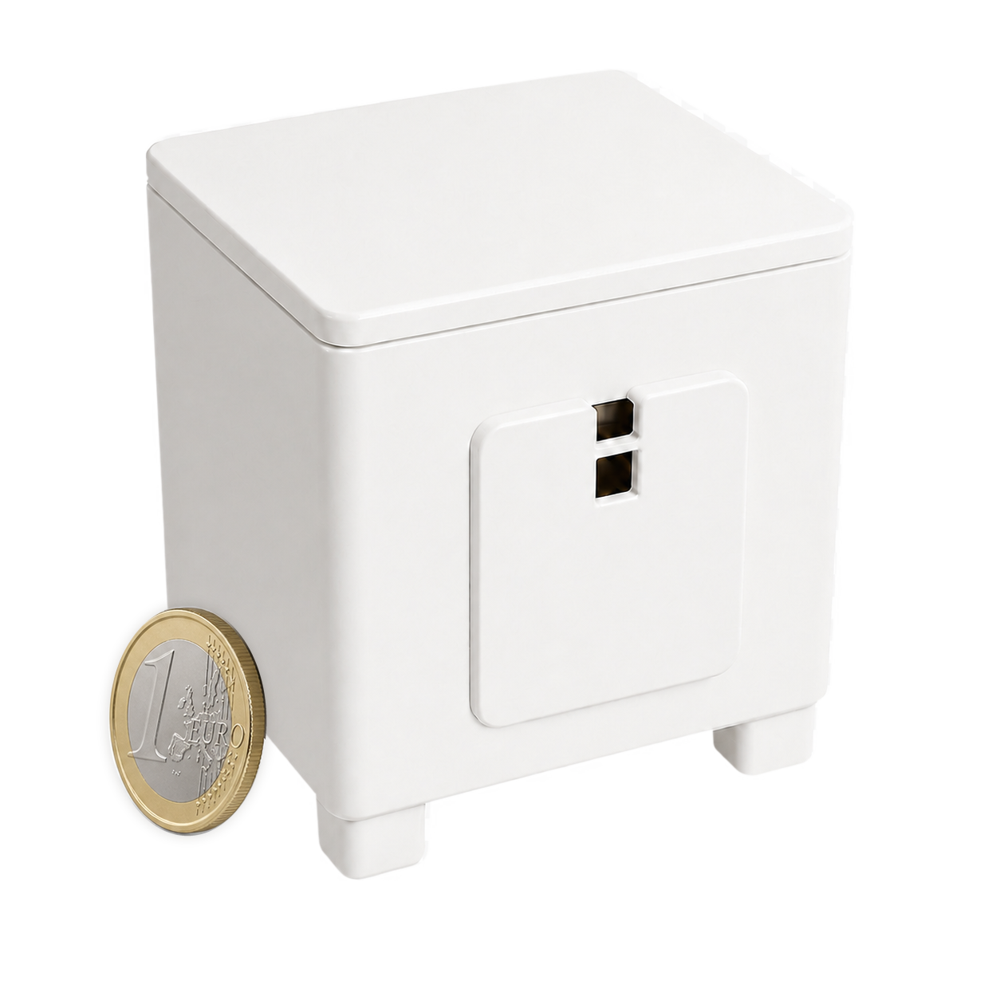
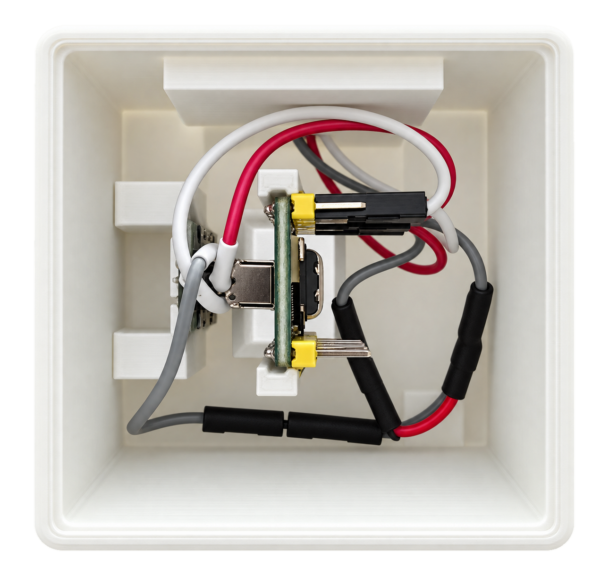
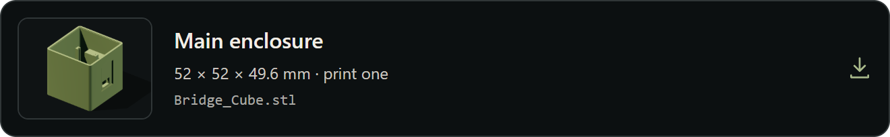
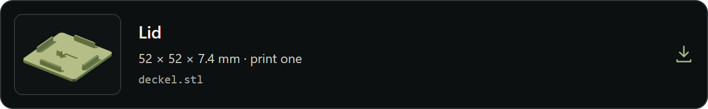
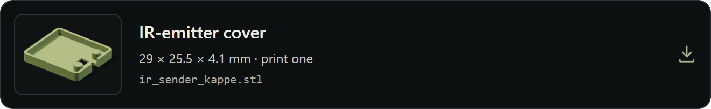
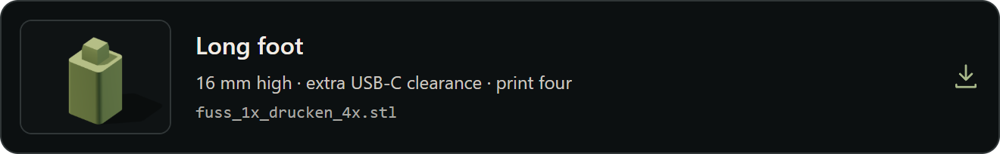
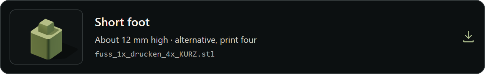

# 3D-printable IR Bridge enclosure

**English** · [Deutsch](de/ir-bridge-enclosure.md) · [Bridge hardware and installation](ir-bridge-installation.md)

The enclosure files package the Waveshare ESP32-S3-Zero, the Adafruit High
Power Infrared LED Emitter and the optional learning receiver into a compact
Bridge housing. Firmware, electronics and wiring are not part of the STL files.

<table>
  <tr>
    <td align="center"> <strong>Closed enclosure and scale</strong></td>
    <td align="center"> <strong>Assembled interior</strong></td>
  </tr>
</table>

The coin is only a size reference. Keep both infrared openings on the front
clear and point the transmitter opening toward the controlled equipment.

## STL downloads and print count

Click a card to download that STL file. The ZIP button downloads the complete bundle.

<a href="https://mermayer.github.io/RoonPilot/ir-bridge/assets/3d/enclosure/Bridge_Cube.stl"><picture><source media="(max-width: 480px)" srcset="../docs/assets/3d/download-cards/Bridge_Cube-en-mobile.png"></picture></a>

<a href="https://mermayer.github.io/RoonPilot/ir-bridge/assets/3d/enclosure/deckel.stl"><picture><source media="(max-width: 480px)" srcset="../docs/assets/3d/download-cards/deckel-en-mobile.png"></picture></a>

<a href="https://mermayer.github.io/RoonPilot/ir-bridge/assets/3d/enclosure/ir_sender_kappe.stl"><picture><source media="(max-width: 480px)" srcset="../docs/assets/3d/download-cards/ir_sender_kappe-en-mobile.png"></picture></a>

<a href="https://mermayer.github.io/RoonPilot/ir-bridge/assets/3d/enclosure/fuss_1x_drucken_4x.stl"><picture><source media="(max-width: 480px)" srcset="../docs/assets/3d/download-cards/fuss_1x_drucken_4x-en-mobile.png"></picture></a>

<a href="https://mermayer.github.io/RoonPilot/ir-bridge/assets/3d/enclosure/fuss_1x_drucken_4x_KURZ.stl"><picture><source media="(max-width: 480px)" srcset="../docs/assets/3d/download-cards/fuss_1x_drucken_4x_KURZ-en-mobile.png"></picture></a>

ZIP with all five STL files. For printing, choose one set of four matching feet: long or short.

Both foot variants have an 8.5 × 8.5 mm model envelope across; the heights are 16 mm (long) and about 12 mm (short).

Use a USB-C cable with a **short connector housing** whenever possible. If a
longer cable plug still lacks clearance below the enclosure, use the longer
`fuss_1x_drucken_4x.stl` foot. Choose **one complete set of four feet** after
checking the required clearance; do not mix long and short versions on one
enclosure. The measurements are model envelopes. Actual fit depends on printer
and material tolerances.

## Assembly outline

1. Complete and electrically inspect the wiring from the
   [Bridge installation guide](ir-bridge-installation.md) before closing the
   housing.
2. Dry-fit the main body, lid, emitter cover and one complete set of four feet.
   Test the short feet first with a short USB-C plug; use four long feet if the
   cable plug otherwise lacks clearance.
3. Position the ESP32-S3-Zero so USB remains accessible and the onboard status
   LED can still be observed as intended.
4. Align the Adafruit emitter with its front opening. Nothing printed or wired
   may shade its infrared path.
5. If this Bridge carries the optional learning receiver, align it with the
   second opening and leave its field of view clear. Other paired Bridges do not
   need a receiver; one learning Bridge can teach profiles for all of them.
6. Route conductors without tension, sharp bends or exposed contacts. The open
   photograph shows the tested component arrangement, not permission for loose
   wiring to touch the board.
7. Power the open assembly, verify status LED, pairing, learning and IR range,
   then disconnect USB before fitting the lid.
8. After closing, repeat the real-equipment IR test and check that the enclosure
   remains mechanically stable and does not develop unexpected heat.

## Placement

- Place the Bridge where the high-power emitter can see the target equipment;
  reflections may work but must be tested in the real room.
- Do not cover the infrared openings or trap the unit behind opaque doors.
- Keep access to USB for Factory recovery even though normal updates are managed
  from RoonPilot.
- A friendly name such as **Living Room** or **Office** can be assigned in
  RoonPilot; the permanent `RPB-…` identity remains the unambiguous hardware ID.

No universal slicer recipe is claimed. Select material, supports, temperatures,
wall count and infill for the printer in use and inspect every part before it is
placed around powered electronics.

The STL files remain subject to the RoonPilot project license. Read the
[licensing guide](licensing.md) before distributing files or printed parts.
