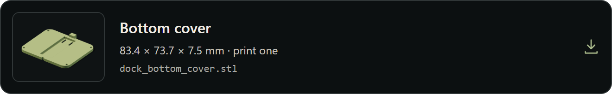
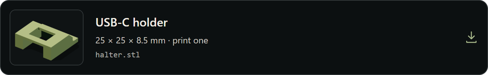
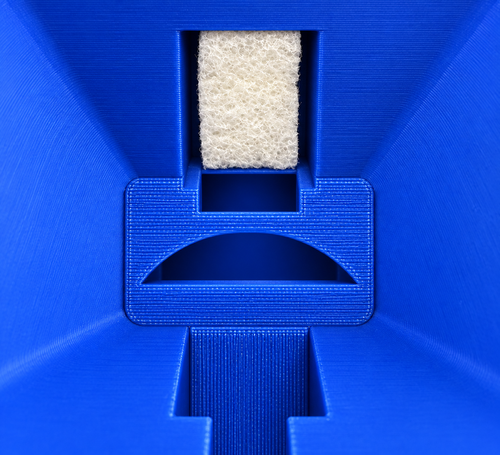
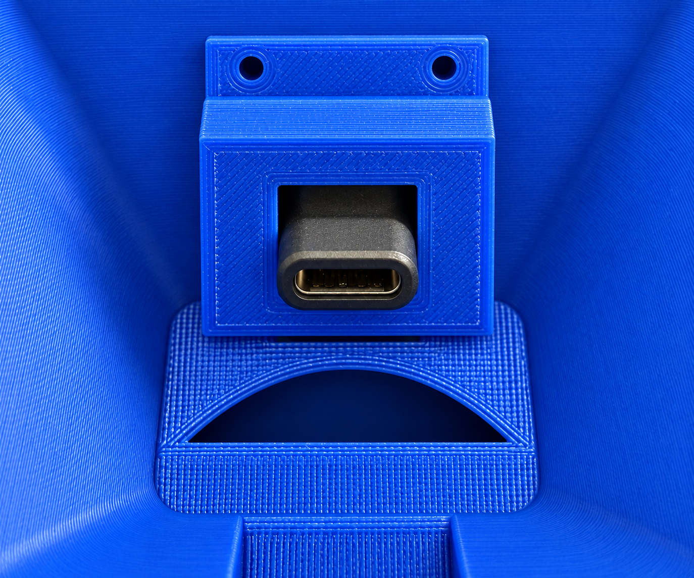
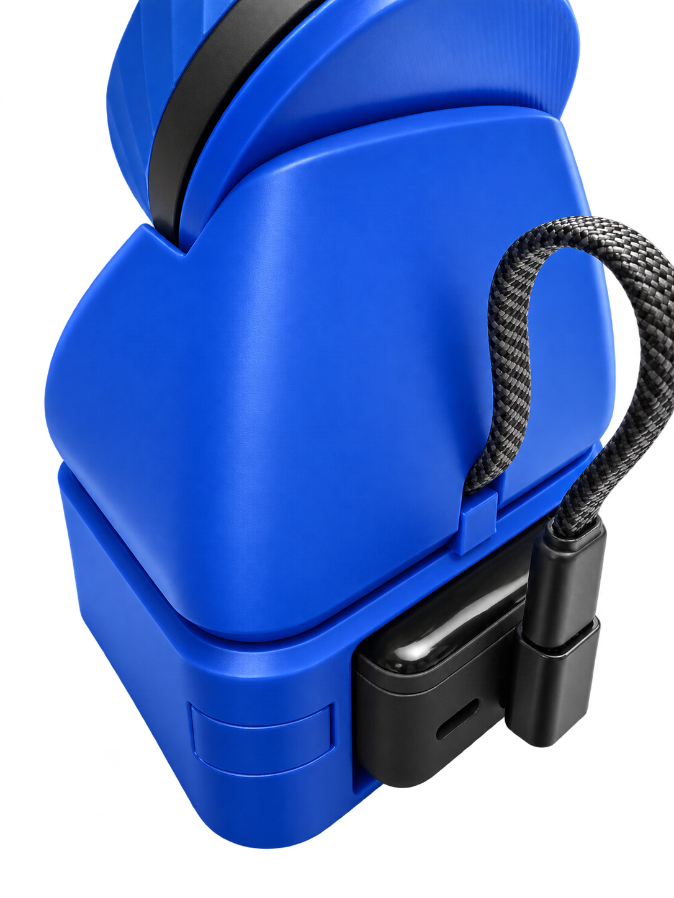
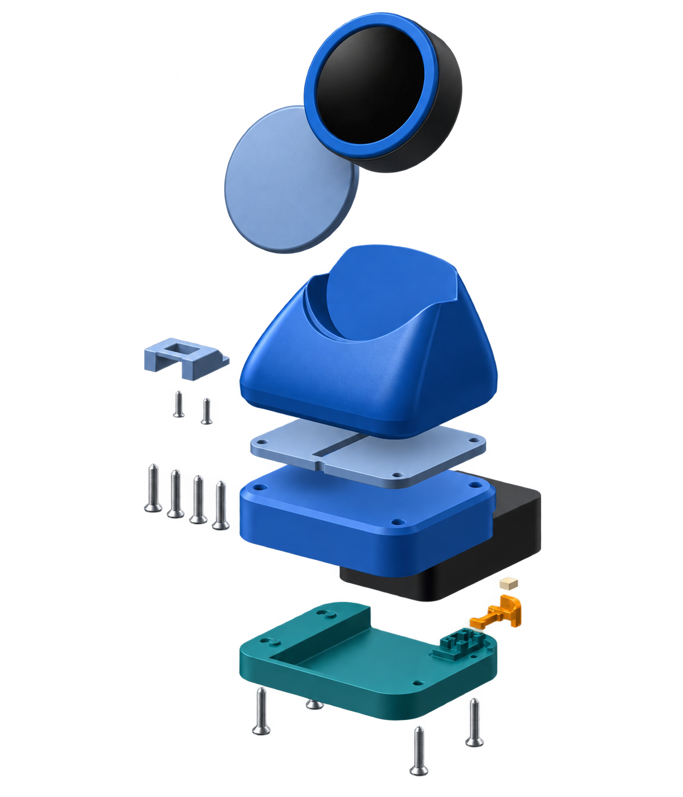
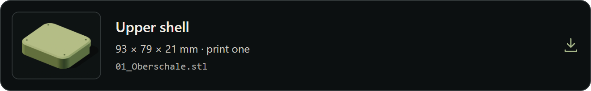
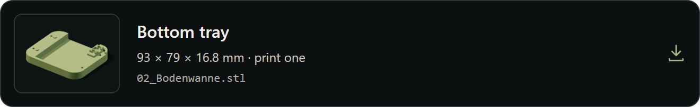

# 3D-printable RoonPilot stand

**English** · [Deutsch](de/roonpilot-stand.md) · [Hardware](hardware-and-two-processors.md)

This optional four-part stand holds the round RoonPilot at a comfortable
viewing angle and brings a USB-C connection into the cradle. It changes no
electronics or firmware and is not required for RoonPilot.

<table>
  <tr>
    <td align="center"> <strong>Stand without RoonPilot</strong></td>
    <td align="center"> <strong>Complete example</strong></td>
  </tr>
</table>

## STL downloads

Click a card to download that STL file. The ZIP button downloads the complete bundle.

Print one of every part:

<a href="https://mermayer.github.io/RoonPilot/assets/3d/roonpilot-stand/dock_body.stl"><picture><source media="(max-width: 480px)" srcset="../docs/assets/3d/download-cards/dock_body-en-mobile.png"></picture></a>

<a href="https://mermayer.github.io/RoonPilot/assets/3d/roonpilot-stand/dock_bottom_cover.stl"><picture><source media="(max-width: 480px)" srcset="../docs/assets/3d/download-cards/dock_bottom_cover-en-mobile.png"></picture></a>

<a href="https://mermayer.github.io/RoonPilot/assets/3d/roonpilot-stand/halter.stl"><picture><source media="(max-width: 480px)" srcset="../docs/assets/3d/download-cards/halter-en-mobile.png"></picture></a>

<a href="https://mermayer.github.io/RoonPilot/assets/3d/roonpilot-stand/rueckwand.stl"><picture><source media="(max-width: 480px)" srcset="../docs/assets/3d/download-cards/rueckwand-en-mobile.png"></picture></a>

ZIP with all seven STL files: four stand parts and three optional power-bank case parts. Prepare the files in your own slicer.

These dimensions describe the model files, not guaranteed finished print
dimensions. Printer calibration, material shrinkage and slicer tolerances can
change the fit. Test the holder and cover before applying force to RoonPilot's
USB-C connector.

## What the mounting photos show

<table>
  <tr>
    <td align="center"> <strong>Underside with foam strip</strong></td>
    <td align="center"> <strong>Magnetic coupler and holder</strong></td>
  </tr>
</table>

`usb_c_install_01` shows the stand from below. Clamp or glue a thin strip of foam
in the position shown. Its thickness depends on the firmness of the selected
foam: it should guide the right-angle magnetic USB-C coupler lightly without
locking it rigidly in place. The coupler must retain a small amount of movement
and be able to align itself after the holder is fitted.

`usb_c_install_02` shows the USB-C holder installed over the coupler. Secure it
with two small screws that fit the existing holes. Adhesive is a poor choice in
this position because the coupler may need adjustment after the first test fit.
The connector must sit centrally and squarely: inserting RoonPilot must not bend
it or use the device's USB-C socket as a structural support.

> [!IMPORTANT]
> Initially tighten the holder only lightly, insert RoonPilot carefully and
> align the magnetic coupler without mechanical stress. Only then tighten both
> screws evenly. The coupler should still yield slightly; it must not lift the
> device or push it sideways.

## Assembly sequence

1. Print the main stand, bottom cover, USB-C holder and rear panel once each.
2. Remove print residue and dry-fit the bottom cover and holder. Do not force a
   tight part; correct printer tolerances first.
3. View the stand from below as in `usb_c_install_01`, then clamp or glue a thin
   foam strip at the position shown. Select its thickness according to the
   firmness of the foam.
4. With power disconnected, centre the right-angle magnetic USB-C coupler on
   the foam. It must remain slightly movable.
5. Fit the printed holder over it as in `usb_c_install_02` and secure it lightly
   with two small suitable screws. Do not glue the holder in place.
6. Insert RoonPilot carefully for a test fit, adjust the coupler until it is free
   of mechanical stress, and only then tighten both screws evenly. Fit the
   bottom cover afterwards.
7. Place the stand on a stable, non-slip surface. Insert RoonPilot vertically and
   without sideways load while watching the USB-C alignment.
8. Connect a stable USB power supply and confirm that the device remains seated
   without cable tension. Remove it immediately if the connector is loaded or
   the enclosure rocks.

The right-angle magnetic USB-C coupler used in the prototype was obtained from
[this Amazon listing](https://www.amazon.de/dp/B0H3C1G3CY?th=1). There are only
a few choices for this coupler type. Even so, verify its dimensions, angle and
pin-through behaviour before purchase; product listings can change
independently of these STL files.

Use a USB-C cable with a **short connector housing** whenever possible. A long
or rigid plug can touch the stand, transfer cable tension to the magnetic
coupler and restrict the small amount of movement it needs. The same
recommendation applies to the RoonPilot IR Bridge.

## Optional power-bank case below the stand

The additional three-part case fits below the existing stand. It is designed for the **INIU Mini Portable Charger, Small 10000mAh 45W**. Use the [linked INIU Amazon listing](https://www.amazon.com/INIU-Portable-10000mAh-Essentials-Powerbank/dp/B0DQD35SQ4) to identify the intended variant: **10,000 mAh, 45 W, ASIN B0DQD35SQ4**.

[Open the illustrated project page](https://mermayer.github.io/RoonPilot/#stand-powerbank)

Rear view (left) and exploded drawing (right). Click either image to enlarge it.

<a href="https://mermayer.github.io/RoonPilot/assets/3d/roonpilot-stand/powerbank-case/01_Oberschale.stl"><picture><source media="(max-width: 480px)" srcset="../docs/assets/3d/download-cards/01_Oberschale-en-mobile.png"></picture></a>

<a href="https://mermayer.github.io/RoonPilot/assets/3d/roonpilot-stand/powerbank-case/02_Bodenwanne.stl"><picture><source media="(max-width: 480px)" srcset="../docs/assets/3d/download-cards/02_Bodenwanne-en-mobile.png"></picture></a>

<a href="https://mermayer.github.io/RoonPilot/assets/3d/roonpilot-stand/powerbank-case/03_Taster.stl"><picture><source media="(max-width: 480px)" srcset="../docs/assets/3d/download-cards/03_Taster-en-mobile.png"></picture></a>

ZIP with the upper shell, bottom tray and button. Print each part once and check the fit before assembly.

These parts supplement the four-part stand. **Print each additional part once.** Dimensions describe the STL models; the finished fit depends on the print. Dry-fit the upper shell, bottom tray and button before fastening. The exploded drawing shows the arrangement of the stand, add-on case, power bank and button.

## Printing notes

No printer-specific temperature, support, wall, infill or material recipe is
claimed here because it has not been validated across printers. Choose settings
appropriate to the material and inspect the finished part for layer separation,
sharp edges and deformation before placing electronics in it.

The STL files are RoonPilot project assets and remain subject to the project
license. Check the [licensing guide](licensing.md) before sharing files or
printed parts.
